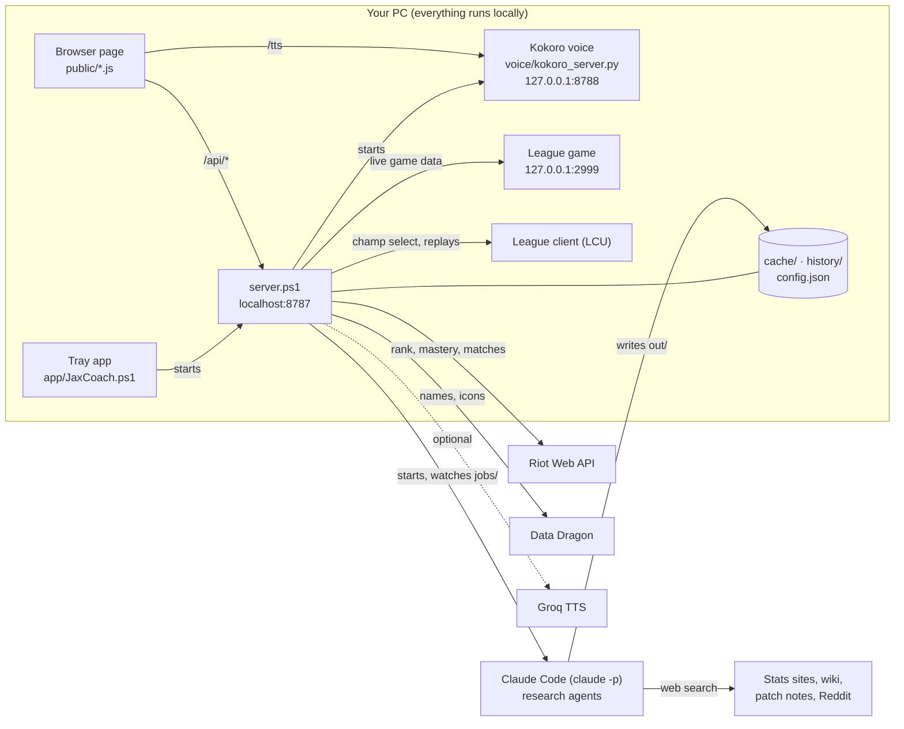

# Jax Coach

A local coaching app for **top lane** in League of Legends. It started as a Jax coach, and now covers any champion
through **playbooks** that research agents build and adapt. It runs on your own Windows PC and shows its advice in your
browser (a second monitor works best):

- **Live dashboard** during the game. One color says what to do right now: All-in, Push, Trade & farm, Play safe,
  Back off or Objective. It also tracks the enemy jungler, objective timers, lane states and when to go back.
- **Voice callouts**, spoken only when something changes. By default a natural-sounding voice runs on your own PC.
- **Champ select prep**: the matchup, build and runes against the enemy laner, and the enemy players' rank and mastery.
- **Game report** after each game: a rating for all ten players, how much of the win/loss was yours, the gold story of
  the game, the three things to fix next time, and "Watch" buttons that jump the League replay to each of your deaths.
- **Review**: patterns over your recent games on a champion (CS at 10, gold at 15, how and where you die) and one focus
  per game.
- **Research agents** (through [Claude Code](https://claude.com/claude-code)):
  - **A playbook for any champion.** Lock in a champion without one and a quick run delivers build and runes within
    about a minute. A full research run (Opus, with Sonnet sub-agents) then writes the whole playbook: matchups,
    game plan and decision rules.
  - **A game plan for every game.** It's made when picks lock (or at game start), and a card shows how this lineup
    is won, the build for it and any extra decision rules.
  - **Plan updates during the game.** At moments that change things (your death, an item spike, big gold swings,
    fed enemies, new threats, Baron or Soul, 14:00/20:00/28:00, or the Reassess button), an agent looks at the game
    again. It updates the build and the plan, including how the game can still be won.
  - **Suggested playbook changes after the game.** A review agent compares what the playbook said with what
    happened. You approve each change; every change is a new playbook version you can roll back.

It only uses Riot's official, read-only interfaces. It never presses keys or clicks for you, and it has no enemy
cooldown or Flash timers.

---

## Install

### Option A: installer (recommended)
1. Download **JaxCoachSetup.exe** from the [Releases](../../releases) page.
2. Run it. Windows may show "Windows protected your PC", because the exe isn't code-signed. Click
   **More info → Run anyway**.
3. Choose a folder. The default is `%LOCALAPPDATA%\Programs\Jax Coach`, which needs no admin rights. Leave
   **Local voice** ticked for the natural voice (downloads about 420 MB) and **Claude Code** for the research agents,
   then click **Install**.

Setup adds a **Jax Coach** shortcut (desktop and Start menu) and an entry under *Windows Settings → Apps*, where you
can uninstall it. The uninstaller asks whether to keep your game history. Running a newer installer on the same folder
updates the app and keeps your settings and history.

Installer options for unattended installs:
`JaxCoachSetup.exe /dir="D:\Jax Coach" /novoice /noclaude /nodesktop /nolaunch /auto`

### Option B: from source
```bat
git clone git@github.com:Snagnar/Jax-Coach.git "%USERPROFILE%\Documents\Jax Coach"
```
Then, in that folder:
1. `Install local voice.bat` (optional; downloads the local voice, about 420 MB)
2. `Create desktop shortcut.bat`
3. Double-click the new **Jax Coach** shortcut.

Everything else is built into Windows 10 and 11: PowerShell 5.1, .NET Framework and a browser.

### Research agents (optional, recommended)
The agents run through **Claude Code**, Anthropic's command-line agent, using your own Claude account.
1. Install it: the installer offers it (checkbox), or run this in PowerShell:
   `irm https://claude.ai/install.ps1 | iex`
2. Sign in once: open the **Playbook** tab, click **Sign in**, follow the link and paste the code back into the window
   that opens.

Without Claude Code everything else works as before, and champions without a playbook get general top-lane advice.

### One-time setup inside the app
- **Riot API key** (needed for enemy rank, mastery and your match history):
  1. Get a free key at <https://developer.riotgames.com>.
  2. Put it in `%USERPROFILE%\.env.txt` as `riot_api_key=RGAPI-...`, or paste it into Settings (gear icon).
  3. Development keys expire every 24 hours; a *Personal API key* doesn't.
- **Your server**: EUW by default; change it in Settings.
- **Replay jumps** in the Game report: add `EnableReplayApi=1` under `[General]` in
  `C:\Riot Games\League of Legends\Config\game.cfg`.
- **Groq voice** (optional cloud voice): add `GROQ_API_KEY=gsk_...` to the same `.env.txt`.

## Using it
Double-click **Jax Coach**. The server starts without a window and a lamp icon appears in the tray:
- **Click the icon** to open the page again.
- **Right-click it** for *Restart server*, *Show log* and *Quit*.

Your browser opens <http://localhost:8787>. Load into a game and the **Live** tab switches on by itself. Play in
borderless mode and keep the page on a second monitor, or alt-tab.

Browsers only allow sound after one click on the page, so click the page once before the game starts.

### Live view
- **Play mode**: the dashboard takes one color for what to do right now: green All-in, violet Push, blue Trade & farm,
  amber Play safe, red Back off, teal Objective. It weighs levels, items, the matchup, your HP, the enemy jungler's last
  sighting, dead players and objective timers. Enemy HP and cooldowns aren't in Riot's data.
- **Don't-fight guard** (before 14:00): when you're a level down, about 500 gold behind or 15+ CS down, the dashboard
  says "Don't fight" and why. After two solo deaths to your lane opponent, the lane locks to "Farm only" until your next
  item is finished.
- **Voice**: speaks only when the play mode changes, or for things you can't see at a glance (the jungler showed bot
  side, an objective spawns in one minute, you can finish an item). The quiet time between lines grows from 8 s in lane
  to 40 s after 25:00. Objective calls use the real names and times: dragons, Dragon Soul, then Elder, grubs, Herald
  and Baron.
- **Dragon Soul point and Elder**: when a team is on 3 drakes (or Elder is next), a striped banner shows who gets Soul
  and the voice plays an alert tone plus one line 90 s before the spawn and again when it's up, even while you're dead.
- **Enemy jungler**: last seen only from the kill feed and objective kills. Nothing is predicted.
- **Lanes**: who is winning each role, plus team item gold, kills, towers and objectives (drakes show soul point).
- **Enemy damage split**: each champion's usual magic/physical share (`damageProfiles` in `data/shared.json`), moved
  by the items they actually buy and weighted by their gold, so it shifts as someone gets fed or builds differently.
  Boots and counter items follow it.
- **One focus per game**: picked from your Review data (the habit that costs you the most). It's shown in champ
  select, tracked live and graded after the game.

### Game report
Opens by itself a few minutes after each game, as soon as Riot publishes the match. You can also pick any of your last
10 games.
- **Verdict**: a 0–10 rating for all ten players. It weighs KDA, deaths, damage share, kill participation, gold, lane
  gold at 15, tower and objective damage, vision and damage taken, weighted by role. It also shows **your share of the
  win or loss**, and MVP / ACE when you were the best player. It's an estimate: calls, roams and wave management aren't
  in the data.
- **Story**: team gold at 15, the biggest lane gap, fed players, throws and comebacks, and a gold chart.
- **Improve next game**: the three biggest leaks with what to do instead. One click makes one of them your next focus.
- **Replay**: download or open the replay, and jump to 15 seconds before each of your deaths.

### Review
Imports your recent games on the champion you have selected (Solo/Duo, Flex, Draft, Quickplay) with their timelines: CS at 10, gold diff at 15, item
timings, and every death classified as gank, solo or fight, with where on the map it happened. "What to work on" ranks
the patterns behind the most deaths.

### Playbook tab
- **Champions**: every champion with a playbook (built-in, researched on this PC, or a draft still being researched).
  Pick one to see it, show it on the dashboard, refresh its research, or switch between its versions. "Add a
  champion" starts research for a new one.
- **Research agents**: whether Claude Code is ready, and what every run is doing right now (searching, reading a
  page, writing a file).
- **Suggested changes**: the post-game review's proposals, each with Apply / Skip.
- **Decision rules**: the fight score terms and the ordered rules the dashboard runs, readable one by one. On the
  Live view, **Why?** under the play mode shows which rule decided and how the fight score was built.

### Voice settings
In Settings you can choose:
- **Voice**: 16 local Kokoro voices (American and British), Groq's voices, or Windows voices.
- **Mix with** another voice, and **Mix amount**, e.g. 70% Nicole + 30% Isabella. A mix costs nothing extra.
- **Speed**, **volume** and an optional chime.

---

## How it works



- **`server.ps1`**: a small web server built on .NET's `HttpListener`, with no dependencies. It serves the page and:
  - proxies Riot's **Live Client Data API** (`127.0.0.1:2999`), which every League game runs locally;
  - reads the **League client** (LCU) for champ select and replays. It finds the client's port and token from its
    process, allows only a short list of read-only endpoints, plus the two replay download/watch calls;
  - proxies the **Riot Web API** (rank, mastery, match history) with your key, caching answers on disk in `cache/`;
  - gets item and champion data from **Data Dragon**, so names, icons and costs follow the current patch.
- **The page** (`public/`) does all the thinking in the browser, about once a second:
  - `engine.js`: game analysis (phase, ahead/behind, play mode, don't-fight guard, jungler tracking, objective timers,
    item picks).
  - `app.js`: the dashboard, champ select, settings and callouts.
  - `voice.js`: speech. It tries the local Kokoro voice first, then Groq, then Windows voices.
  - `report.js`: Game report ratings and the replay jumps.
  - `review.js` and `focus.js`: match-history patterns and the focus of the game.
  - `scout.js`: enemy rank and mastery.
  - `demo.js`: a demo game for trying the dashboard without playing.
- **Playbooks**: the coaching knowledge per champion, four JSON files (format: [agents/playbook-format.md](agents/playbook-format.md)).
  - `meta.json`: build, runes, items (with "build when" tags) and skill order.
  - `phases.json`: the plan for each phase and advice per trigger.
  - `matchups.json`: notes, difficulty and win rates per lane opponent.
  - `rules.json`: the in-game decisions. There is a *fight score* (terms like "you have your ultimate, they don't:
    +2") and an ordered list of rules ("when `min < 14 && e >= 2` → All-in on {oppName}"). They're written in a
    small, safe expression language (`public/rules.js`, no `eval`), so agents can rewrite them without touching code.
    The Jax rules reproduce the original hand-written logic exactly; this was checked on about 12,000 simulated
    game states.
  - Built-in playbooks live in `data/champions/<Champion>/` (Jax, plus the generic fallback in `_generic/`). Versions
    made on your PC live in `playbooks/<Champion>/v<N>/`, and the active one wins file by file.
- **Research agents** (`agents/`): `runner.ps1` starts each job as `claude -p` in its own folder under `jobs/`.
  - Restricted mode: no shell commands, file access only inside that folder, web search and reading allowed.
  - New champions use Opus; everything else, and all sub-agents, use Sonnet (`agentModelDeep`, `agentModel` and
    `agentSubagentModel` in `config.json` change that).
  - The prompts are in `agents/prompts/`. The server installs finished playbooks; the page applies plans and shows
    proposals.
  - Agents only see champions, never player names, and never give advice based on timing enemy cooldowns.
- **The local voice** (`voice/`): [Kokoro-82M](https://huggingface.co/hexgrad/Kokoro-82M) via
  [kokoro-onnx](https://github.com/thewh1teagle/kokoro-onnx), set up by `voice/setup-voice.ps1`.
  - It uses its own private Python (made by [uv](https://github.com/astral-sh/uv)), so nothing is installed
    system-wide.
  - It runs on 2 CPU threads at below-normal priority, so it doesn't compete with the game, and quits when the server
    stops.
  - Every sentence is cached in `cache/tts`, so repeated lines play instantly.
  - A gentle 7 kHz low-pass removes Kokoro's metallic top end.
  - `"voiceDevice": "gpu"` in `config.json` would run it through DirectML (the model then has to be patched with
    `voice/patch_dml.py`). It's faster but sounds worse on some cards, so the CPU is the default.
- **The tray app** (`app/JaxCoach.ps1`, started by `Jax Coach.vbs`) keeps the server running without a console window.
  Logs are in `logs/`.

### Files that stay on your PC
These are git-ignored and never in the installer:
- `config.json`: your settings, including a Riot key if you pasted one in Settings.
- `history/`: your own games.
- `playbooks/`: playbook versions made on your PC.
- `jobs/`: research agent runs (prompt, input, what the agent did, its output).
- `cache/`: Riot answers, game data and voice lines. Settings → Storage shows the size of each part and can clear the
  caches (playbooks and game records are never cleared there).
- `logs/`
- the downloaded voice in `voice/`.

API keys from `.env` files are never copied into `config.json`.

## Development
- Run the server with a console: `Start Jax Coach.bat`. Edit the files in `public/` and reload the page.
- Try the dashboard without a game: open the **Live** tab and start the demo game.
- **Build the installer**:
  ```bat
  powershell -ExecutionPolicy Bypass -File installer\build.ps1
  ```
  It writes `dist\JaxCoachSetup.exe`, using the C# compiler that ships with Windows (no SDK needed). The version comes
  from `installer\version.txt`. The installer contains the app files only (`installer/build.ps1` lists them). The voice
  is downloaded during setup.
- **New patch**: click **Refresh research** on the Playbook tab (per champion). Item names that no longer exist in
  Data Dragon get a dashed border in the app.
- **Ship a researched playbook**: copy `playbooks/<Champion>/v<N>/*.json` to `data/champions/<Champion>/` and commit.

## Troubleshooting
- **Nothing happens when I start it**: right-click the tray icon → *Show log*, or run `Start Jax Coach.bat` to see
  errors.
- **No voice**:
  1. Click the page once (browsers block sound until you do).
  2. Check the voice button in the Live banner.
  3. If the local voice is missing, run `Install local voice.bat`.
- **No rank or mastery**: the Riot key is missing or expired. The gear icon shows its status.
- **"AI: sign in" / no research**: sign in on the Playbook tab. A failed run shows its error there; the full log of
  each run is in `jobs/<run>/events.jsonl` and `stderr.txt`.
- **Port 8787 is taken**: set `"port": 8790` in `config.json`.

---

Jax Coach isn't endorsed by Riot Games and doesn't reflect the views or opinions of Riot Games or anyone officially
involved in producing or managing Riot Games properties. Riot Games and all associated properties are trademarks or
registered trademarks of Riot Games, Inc.
